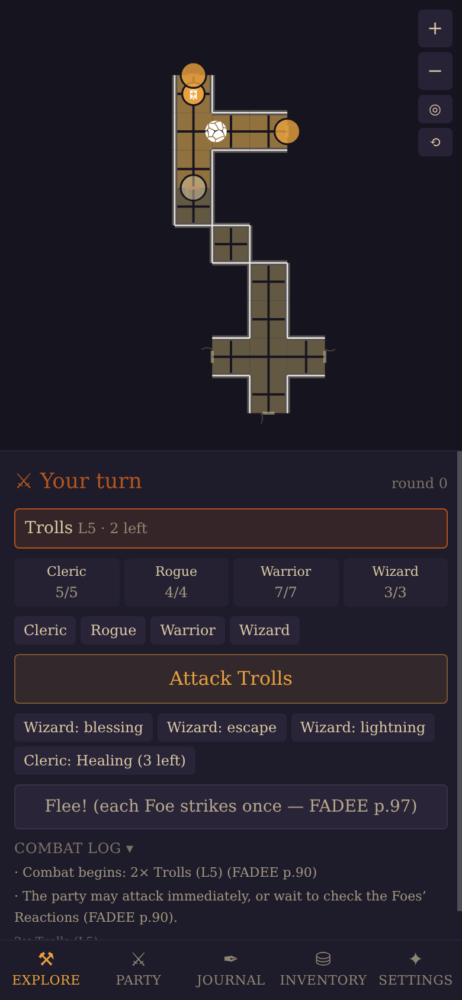
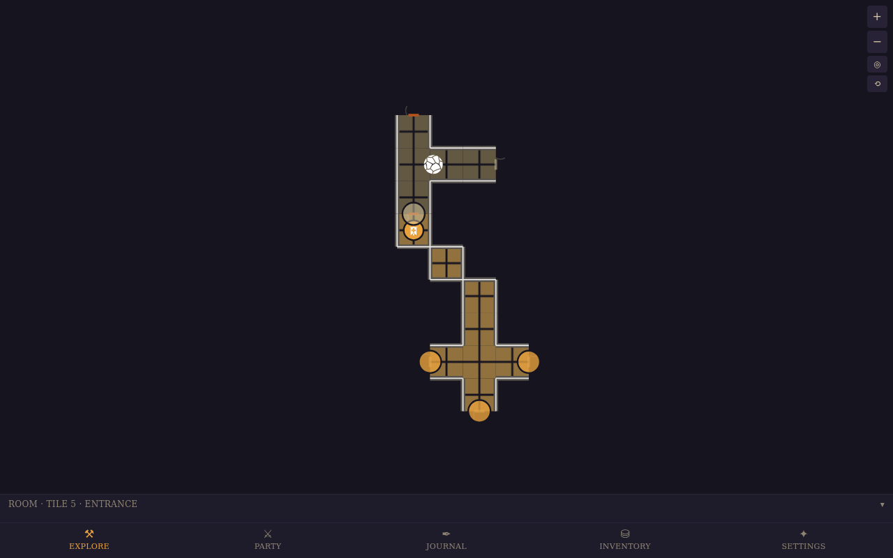
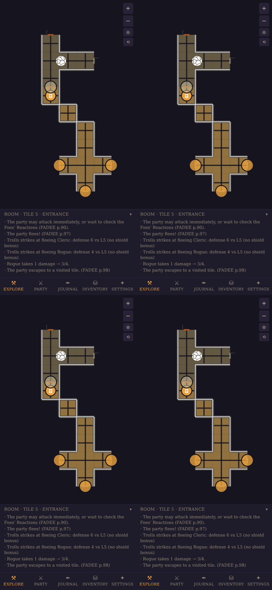
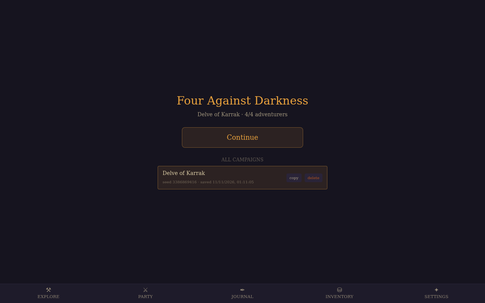
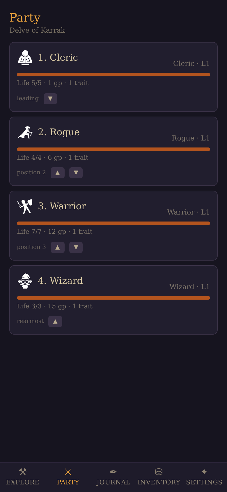
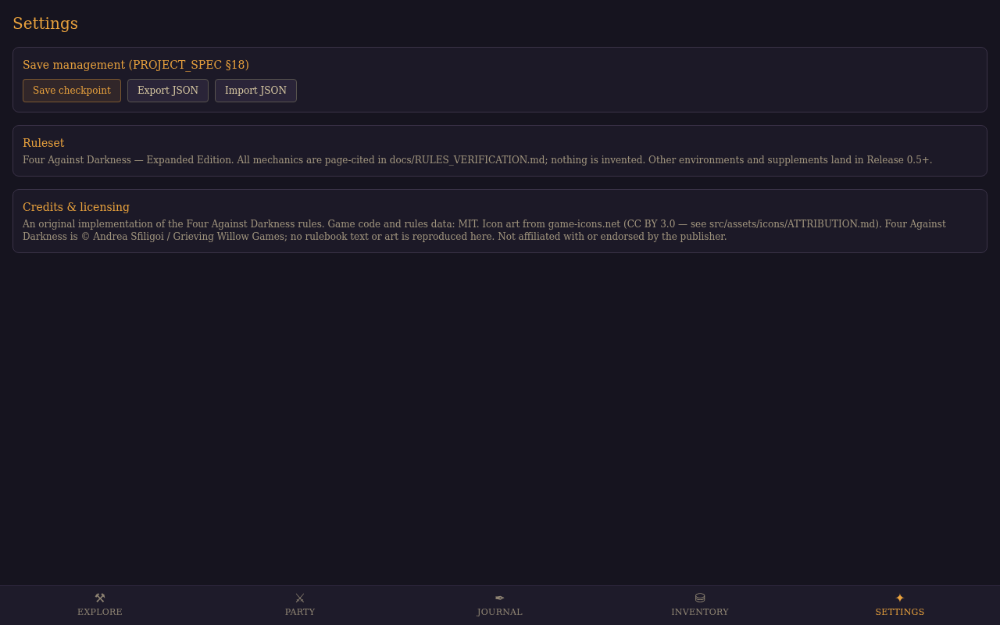

# four-against-darkness-pwa

A fully playable digital adaptation of **Four Against Darkness — Expanded Edition** as an
iPhone-first Progressive Web App. The app automates the bookkeeping — dungeon generation,
encounters, dice, combat math, treasure, XP — while the player keeps the meaningful decisions.

- Solo dungeon crawler, offline after install, no account, no server.
- Seeded deterministic RNG; every roll is logged and explainable.
- Rules data is page-cited to the Expanded Edition in `docs/RULES_VERIFICATION.md`.

## Screenshots

| Mobile (iPhone, portrait) | Desktop |
| --- | --- |
|  |  |
|  |  |
|  |  |

Icon art: [game-icons.net](https://game-icons.net) (CC BY 3.0) — see
`src/assets/icons/ATTRIBUTION.md`. All map floors, walls and door glyphs are
procedural SVG (original, MIT).

## Development

```bash
npm install
npm run dev      # local dev server
npm test         # Vitest unit/integration/simulation suites
npm run build    # type-check + production build (PWA)
```

See `docs/` for the full specification, architecture, rules verification ledger, and
implementation status. Licensed MIT — original code and data; no rulebook text is
reproduced.
